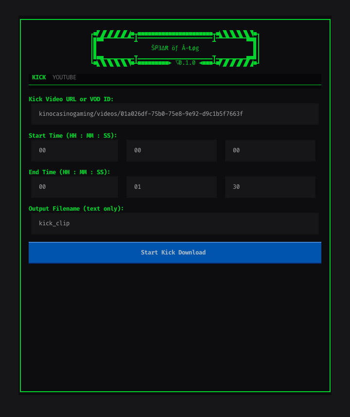

# SPEAR OF A-LOG



## COMMANDS

Run the app with the following command:

```bash
uv run python src/spear_of_a_log/app.py
```

### NOTES

- This uses `uv` to manage the virtual environment and dependencies.
- I will expand this readme later.
